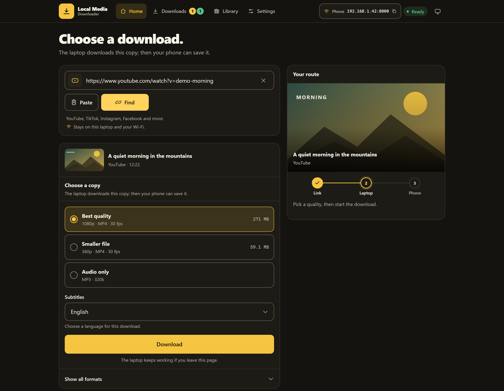
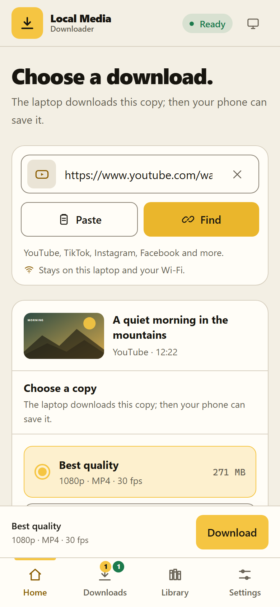
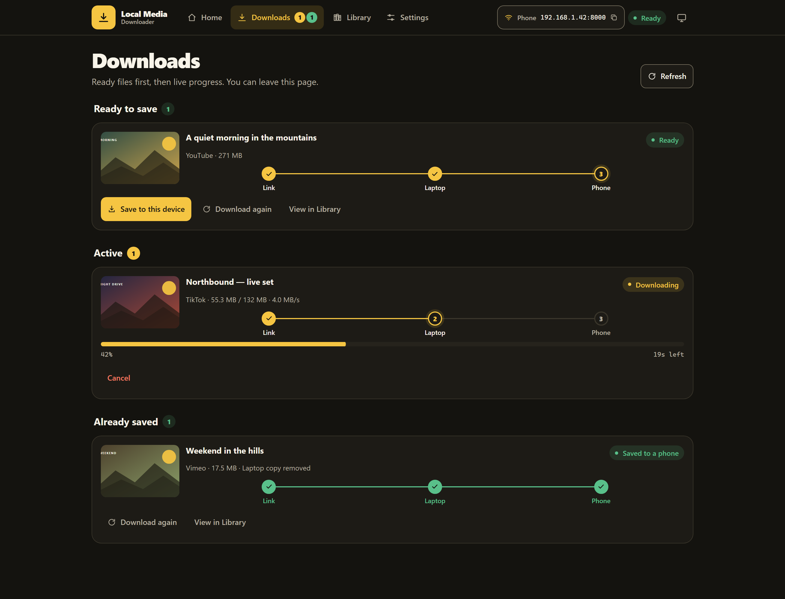
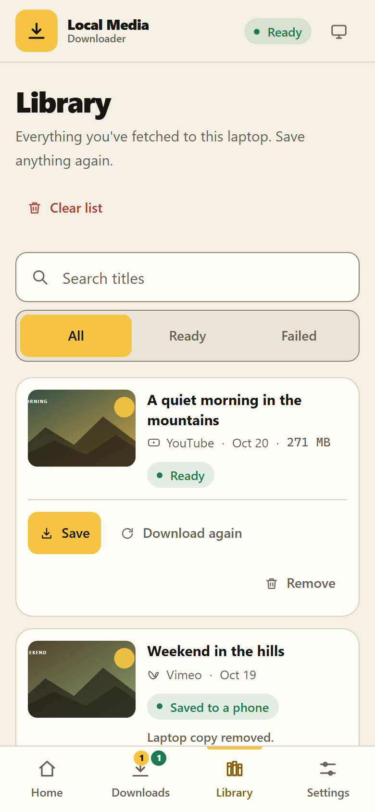

# Local Media Downloader

**A private, local media downloader for your laptop and phone.**<br>
Paste a link → fetch it on your laptop → save the finished file to your phone. No accounts, no cloud, no subscriptions. Everything runs on hardware you own, over your own Wi-Fi.

[](LICENSE)
[](https://www.python.org/)
[](https://react.dev/)
[](https://fastapi.tiangolo.com/)

> Screenshots use an isolated demo preview with representative data. No personal Library, download history, or files are shown.

## Screenshots

| Desktop | Phone |
|:---:|:---:|
| <a href="docs/screenshots/home-desktop.png"></a> | <a href="docs/screenshots/home-mobile.png"></a> |
| **Downloads** | **Library** |
| <a href="docs/screenshots/downloads-desktop.png"></a> | <a href="docs/screenshots/library-mobile.png"></a> |

## Why this exists

Most download tools ask you to upload a link to someone else’s server, create an account, or decipher a wall of format codes. This one keeps the whole pipeline at home:

- The **laptop** does the fetching, merging, and storing.
- The **phone** is a remote control and a destination, not a worker.
- The **finished file** moves over your LAN only when you explicitly save it.
- The **Library** remembers what happened without pretending a removed file is still available.

The interface is designed for one-handed phone use first: large targets, short copy, honest progress, and a clear next action in every state.

## Features

- **Paste, drop, or tap Paste** to inspect a link before downloading.
- **Real format choices** from yt-dlp: best quality, a smaller file, audio-only, or a specific format. The desktop view also exposes the full format ledger.
- **Audio-only downloads** as MP3 at **320 kbps by default** (192/128 available), with thumbnail and metadata embedding.
- **Per-download subtitles**: manual captions first, optional auto-generated fallback, embedded in MP4 or saved as a sidecar `.srt`.
- **Playlist support**: inspect a playlist, see what is already in your archive, and download only the new episodes as individually tracked jobs.
- **Live progress over SSE** for queued, extracting, downloading, merging, finished, cancelled, and failed jobs. Jobs keep running when you leave the page.
- **SaveLink preflight**: the app checks that the file still exists before starting a download, so a gone file never becomes a saved JSON error.
- **Two-machine language**: “On this laptop,” “Ready to save,” and “On your phone” are distinct states. The laptop copy is removed after a phone save when that setting is enabled.
- **Library** with search, Ready/Failed filters, save-again, download-again, remove, and clear-list actions.
- **Settings** for System/Dark/Light theme, preferred quality, audio default, concurrency limit, download folder, auto-delete after phone save, subtitle mode/language, cookie upload, metadata/thumbnail embedding, and an optional FFmpeg path.
- **PWA shell** with a web manifest, icon set, and service worker.
- **Accessible by default**: 44px+ touch targets, visible focus, keyboard-operable controls, live status announcements, and reduced-motion support.

## Tech stack

| Area | Technology | Used for |
|---|---|---|
| Backend | [Python 3.12+](https://www.python.org/), [FastAPI](https://fastapi.tiangolo.com/), [Uvicorn](https://www.uvicorn.org/) | Typed API, SSE progress, static frontend serving |
| Media engine | [yt-dlp](https://github.com/yt-dlp/yt-dlp), [FFmpeg](https://ffmpeg.org/) | Metadata probing, format selection, downloading, merging, audio extraction, subtitles |
| Data | [SQLite](https://www.sqlite.org/), [SQLAlchemy](https://www.sqlalchemy.org/), [Pydantic](https://docs.pydantic.dev/) / pydantic-settings | Library history, JSON settings, request/response schemas |
| Frontend | [React 18](https://react.dev/), [TypeScript 5](https://www.typescriptlang.org/), [Vite 5](https://vitejs.dev/) | Single-page app and production build |
| Styling | [Tailwind CSS 3](https://tailwindcss.com/), local shadcn-inspired primitives | Design tokens, responsive layout, accessible components |
| Routing | [React Router 6](https://reactrouter.com/) | Home, Downloads, Library, Settings |
| Tooling | [uv](https://docs.astral.sh/uv/), [npm](https://www.npmjs.com/), [pytest](https://docs.pytest.org/) | Environment, build, and regression tests |
| Delivery | Web manifest + service worker | Installable app shell and offline static shell on localhost |

The frontend deliberately has a small dependency surface: `clsx` and `tailwind-merge` for class composition, with the UI primitives kept in `frontend/src/components/ui/` instead of pulling in a full component framework.

## Quick start

### Prerequisites

- **Python 3.12+** with [uv](https://docs.astral.sh/uv/) (recommended) or plain `pip`
- **Node.js 18+** and npm
- **FFmpeg** on `PATH` (required for merging and audio extraction)
- Optional: a phone or tablet on the same local network

Install FFmpeg on Windows with:

```powershell
winget install Gyan.FFmpeg
ffmpeg -version
```

On macOS: `brew install ffmpeg`. On Debian/Ubuntu: `sudo apt install ffmpeg`.

### Clone and install

```powershell
git clone https://github.com/YAC223E/local-media-downloader.git
cd local-media-downloader
uv sync --extra dev
```

If you prefer plain pip, create a virtual environment and install the packages listed in `pyproject.toml`:

```powershell
python -m venv .venv
.\.venv\Scripts\Activate.ps1
pip install fastapi "uvicorn[standard]" yt-dlp sqlalchemy pydantic pydantic-settings python-multipart pytest httpx
```

### Run the backend

```powershell
uv run uvicorn app.main:app --host 0.0.0.0 --port 8000
```

The API is now at `http://localhost:8000`. The app shows the laptop’s LAN URLs on the Home screen.

### Run the frontend in development

In a second terminal:

```powershell
cd frontend
npm install
npm run dev
```

Open `http://localhost:5173`. Vite proxies `/api` to the FastAPI server on port 8000.

### Build the single-origin app

For normal use, build the frontend once and let FastAPI serve it:

```powershell
cd frontend
npm run build
cd ..
uv run uvicorn app.main:app --host 0.0.0.0 --port 8000
```

Open `http://localhost:8000` on the laptop, or `http://<laptop-lan-ip>:8000` on a phone connected to the same Wi-Fi.

> If the phone cannot connect, allow Python through Windows Firewall on **Private** networks and confirm both devices are on the same subnet. Do not expose this service to the public internet; it has no authentication.

## How to use

1. **Copy a media link** from a site supported by yt-dlp.
2. On **Home**, paste the link (or tap **Paste**) and choose **Find**. The app reads the metadata and available formats without downloading.
3. Pick **Best quality**, **Smaller file**, **Audio only**, or open **Show all formats** on desktop for a specific stream. Choose a subtitle language if the source has captions.
4. Choose **Download**. The laptop fetches and prepares the file. You can close the page or lock the phone; the job continues on the laptop.
5. Open **Downloads** to see **Ready to save**, **Active**, and **Already saved** jobs. A ready file stays on the laptop until you save it.
6. On the phone, tap **Save to this device**. The app preflights the file, starts the transfer, and then shows **On your phone** / **Saved to a phone** using the local device marker.
7. Open **Library** to search, filter, save again, download again, or remove history rows. Removing a Library row does not delete the downloaded file.

### Where files go

By default, finished media lands in:

- Windows: `%USERPROFILE%\Downloads\Local Media Downloader\`
- macOS/Linux: `~/Downloads/Local Media Downloader/`

Change the folder on **Settings**. Server-side files are filed under `<Platform>/` for LAN downloads and `This Laptop/<Platform>/` when the request comes from the laptop itself.

## Configuration and local data

These files are intentionally ignored by Git:

| Path | Purpose |
|---|---|
| `settings.json` | Runtime settings from the Settings page |
| `history.db` | SQLite Library history |
| `downloads/` | Legacy/project-local download shelf fallback |
| `cookies/cookies.txt` | Optional Netscape-format cookies for login-gated sites |
| `archives/` | yt-dlp playlist archive files (already-downloaded episode IDs) |
| `frontend/dist/` | Production frontend build |
| `*.log` | Server and local logs |

Set `FFMPEG_PATH` if FFmpeg is not discoverable automatically. An explicit path saved in Settings takes precedence.

## API overview

| Method | Endpoint | Purpose |
|---|---|---|
| `GET` | `/api/health` | Liveness check |
| `GET` | `/api/system` | FFmpeg readiness and LAN URLs |
| `POST` | `/api/fetch` | Probe metadata and formats without downloading |
| `GET` | `/api/downloads` | Live jobs |
| `POST` | `/api/downloads/start` | Start one download |
| `POST` | `/api/downloads/start-playlist` | Start new episodes from a playlist |
| `GET` | `/api/downloads/{id}/events` | SSE progress stream |
| `POST` | `/api/downloads/{id}/cancel` | Cancel a job |
| `GET` | `/api/downloads/{id}/file` | Serve a finished file; `?check=1` is the preflight |
| `GET` | `/api/history` | Library rows |
| `DELETE` | `/api/history/{id}` | Remove one Library row |
| `DELETE` | `/api/history` | Clear Library rows (files are untouched) |
| `GET` / `PUT` | `/api/settings` | Read/update settings |
| `POST` / `DELETE` | `/api/settings/cookies` | Upload/remove a cookies file |

## Project structure

```text
local-media-downloader/
├── app/
│   ├── main.py                 FastAPI entrypoint + static frontend serving
│   ├── config.py               settings.json, folders, FFmpeg resolution
│   ├── db.py                   SQLite/SQLAlchemy setup
│   ├── downloads_manager.py    threaded jobs, progress, cancellation
│   ├── ytdlp_service.py        yt-dlp probe/download wrapper
│   ├── models.py               DownloadRecord
│   ├── schemas.py              API schemas
│   └── routes/                 info, downloads, history, settings, system
├── frontend/
│   ├── src/
│   │   ├── pages/              Home, Downloads, Library, Settings
│   │   ├── components/         RouteStrip, JobCard, SaveLink, QualityPicker…
│   │   ├── components/ui/      local button/input/badge/select primitives
│   │   └── lib/                API client, jobs context, formatters, theme
│   └── public/                 manifest, icons, service worker source
├── tests/                      pytest regression suite
├── docs/screenshots/           README screenshots caught from the demo preview
├── DESIGN.md                   Departure Board design system
├── PRODUCT.md                  product truth and constraints
└── pyproject.toml              Python dependencies and pytest config
```

## Testing

Run the backend suite from the repository root:

```powershell
uv run pytest -q
# or
python -m pytest -q
```

Build the frontend with:

```powershell
cd frontend
npm run build
```

The suite covers retry/history behavior, file resolution and transfer cleanup, audit/smoke paths, and playlist flow. The production build runs `tsc -b` followed by Vite.

## Privacy, security, and limitations

- **Local by design.** There is no cloud account, telemetry, or third-party storage. Files move between your laptop and your devices on your LAN.
- **No authentication.** The FastAPI service is intended for a trusted home network. Do not port-forward it or expose it to the internet. CORS is permissive so LAN browsers can call the API directly.
- **Cookies are sensitive.** `cookies/cookies.txt` can grant access to your accounts on supported sites. It is gitignored; delete it from Settings when you no longer need it.
- **Site support follows yt-dlp.** Extractors change when sites change. Update yt-dlp if a link stops working.
- **DRM is not supported.** The app cannot download protected streams.
- **Some sites need a login.** Use the cookies upload in Settings for private or login-gated content.
- **HTTP has browser limits.** Clipboard reads may be blocked over plain HTTP; the app tells you to paste manually. The PWA offline shell works on `localhost`; over a LAN IP the shortcut and standalone window still work, but the shell loads from the laptop each time. HTTPS (for example with `mkcert`) is future work.
- **Auto-delete only removes the server copy.** Library history remains, and the UI shows that the laptop copy was removed.

## Design

The visual system is called **The Departure Board**: saffron and ink, a three-stop route (Link → Laptop → Phone), honest measurements, and one obvious next action. Read [DESIGN.md](DESIGN.md) for tokens, components, motion, and accessibility rules. Product constraints and confirmed behavior live in [PRODUCT.md](PRODUCT.md).

## References and inspiration

- [FastAPI documentation](https://fastapi.tiangolo.com/)
- [yt-dlp project](https://github.com/yt-dlp/yt-dlp)
- [FFmpeg documentation](https://ffmpeg.org/documentation.html)
- [React documentation](https://react.dev/)
- [Vite guide](https://vitejs.dev/guide/)
- [Tailwind CSS documentation](https://tailwindcss.com/docs)
- [React Router documentation](https://reactrouter.com/)
- [SQLAlchemy documentation](https://docs.sqlalchemy.org/)
- [shadcn/ui](https://ui.shadcn.com/) — inspiration for the local UI primitives; this project does not depend on it.
- [Playwright](https://playwright.dev/) — used to capture the README screenshots from an isolated demo preview.

## License

Released under the [MIT License](LICENSE). Copyright © 2026 Cheick YACOUBA.
